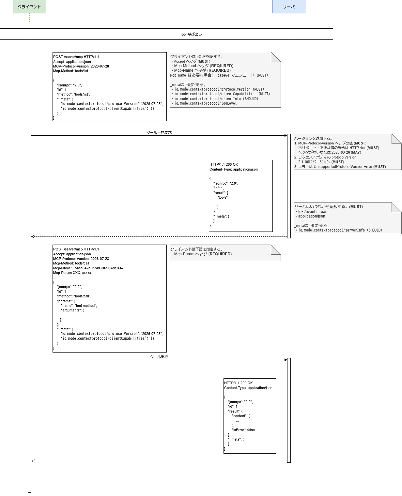

# フロー

プロトコルバージョン `2026-07-28` について記載する。

## Streamable HTTP

1 つのエンドポイントに対して HTTP POST と Server Sent Events (SSE) の 2 つのステートレスな HTTP セッションを使用する。
サーバからクライアントへの通知が不要な場合は SSE は必要ない。

SSE を使用する場合のフローは省略する。
SSE は `Accept: text/event-stream` を指定して開始する。
